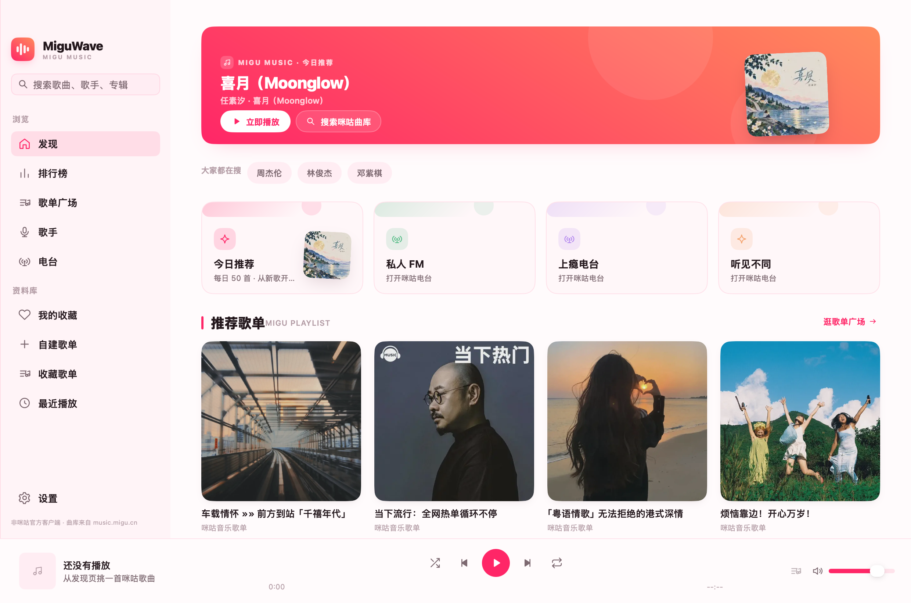
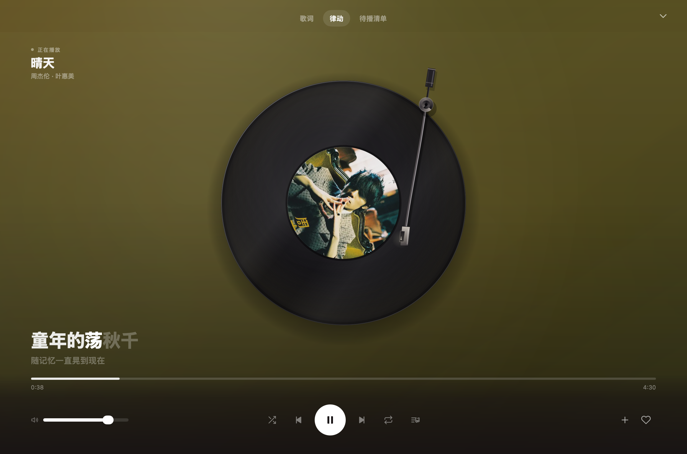
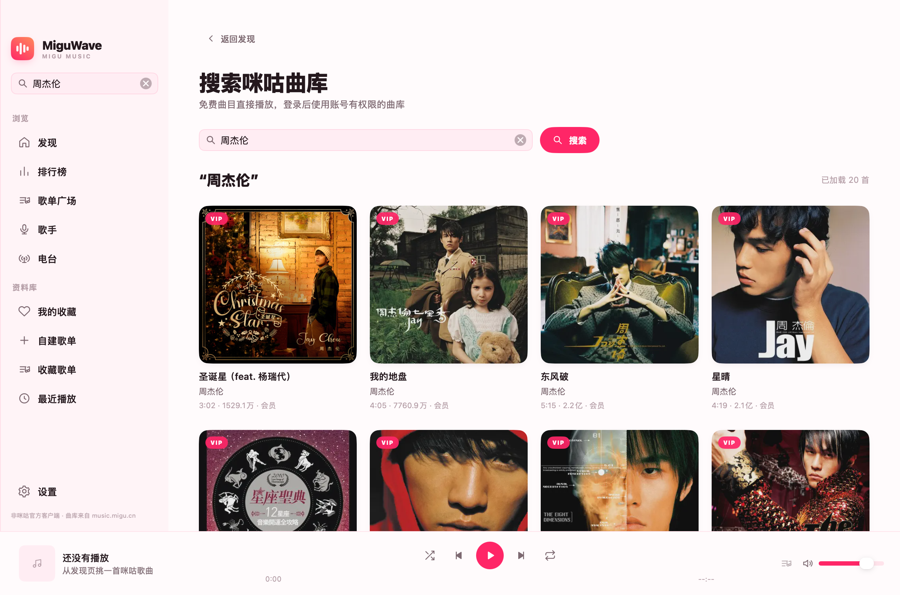
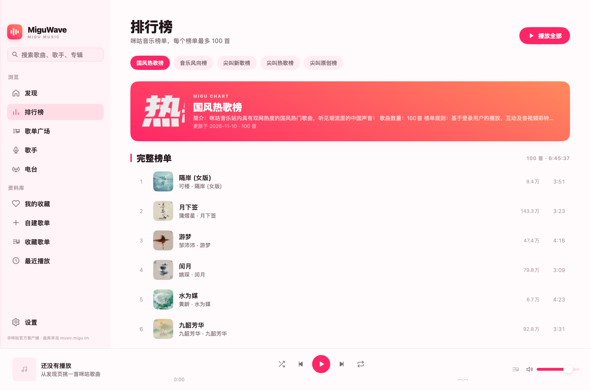
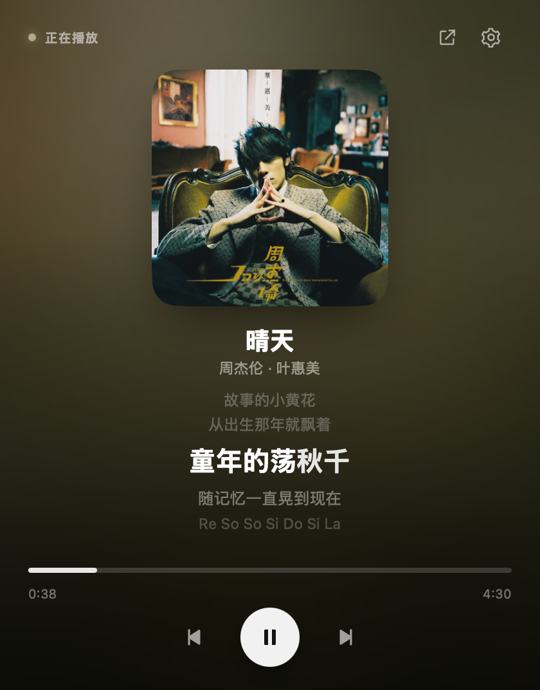

# MiguWave

[](https://github.com/horizon0514/MiguWave/actions/workflows/ci.yml)

用 Go 和 [MyGo](https://github.com/egoist/mygo) 写的咪咕音乐桌面客户端。原生界面，Windows 与 macOS 共用一套代码，专注 `music.migu.cn` 曲库。

> 非咪咕官方客户端。接口来自咪咕网页端，可能随官方调整而失效。请使用自己的账号和会员权益，本应用不提供绕过付费墙或下载导出的能力。

## 界面预览

| 发现 | 沉浸式播放 |
|:---:|:---:|
|  |  |

| 搜索 | 排行榜 |
|:---:|:---:|
|  |  |

<p align="center">
  
  <br>
  <sub>菜单栏 / 系统托盘播放面板</sub>
</p>

## 安装

发布包同时提供 macOS 通用应用与 Windows 安装包，可从 [Releases](https://github.com/horizon0514/MiguWave/releases) 下载。

### macOS

要求 macOS 12 或更高版本。

1. 打开 `miguwave-0.1.3.dmg`。
2. 把「MiguWave」拖进「应用程序」。
3. 首次启动时，如果 macOS 提示无法验证开发者，在 Finder 中右键应用并选择「打开」。

当前公开构建使用 ad-hoc 签名，尚未经过 Apple 公证。若系统直接提示应用已损坏，可在终端执行：

```bash
xattr -dr com.apple.quarantine /Applications/MiguWave.app
```

然后重新打开应用。正式对外分发前，建议配置 Apple Developer ID 并完成公证，步骤见 [RELEASE.md](RELEASE.md)。

### Windows

要求 Windows 10 1809+ 或 Windows 11，以及 WebView2 Runtime（Windows 11 自带，旧系统可安装 Evergreen Runtime）。

1. 运行 `miguwave-setup-0.1.3-amd64.exe`（Intel / AMD）或 `miguwave-setup-0.1.3-arm64.exe`（ARM64 设备）。
2. 安装到当前用户目录，不需要管理员权限。
3. 当前构建未做代码签名，SmartScreen 提示时点「更多信息」→「仍要运行」。
4. 如果缺少 WebView2，应用内登录页会提示无法打开；安装 Runtime 后重试即可，扫码和令牌导入不受影响。

## 功能

- 发现页：今日推荐、私人 FM / 上瘾电台 / 听见不同入口、推荐歌单、新歌速递、热门榜单、热搜词
- 排行榜：国风热歌榜、音乐风向榜、尖叫新歌榜、尖叫热歌榜、尖叫原创榜，每榜最多 100 首
- 歌单广场：编辑推荐、歌单百宝箱、深度歌手、歌单上新，歌单详情支持分页加载、播放全部与收藏
- 歌手：华语、欧美、日韩分类浏览，歌手详情包含简介、热门歌曲与相似歌手
- 电台：私享电台、时序电台和场景电台；私人 FM / 上瘾电台 / 听见不同登录后按账号口味推荐
- 搜索：歌曲、歌手、专辑搜索，结果分页加载，自动去重
- 播放：免费曲目直接解析播放；登录咪咕账号后可播放账号有权限的曲目
- 歌曲详情：封面、专辑、时长、音质与版权信息，支持滚动歌词和点击歌词跳转播放
- 自建歌单：新建、重命名、删除歌单，从歌曲卡片、列表或歌曲详情加入歌曲，歌曲不会重复
- 收藏歌曲、收藏歌单、最近播放、自建歌单与本地持久化
- 底部播放器、音量、随机、循环、系统媒体键与系统媒体控制（macOS Now Playing / Windows SMTC）
- macOS 菜单栏 / Windows 系统托盘：点击图标展开当前歌曲、歌词与播放控制，可随时打开完整窗口
- 窗口行为：关闭主窗口默认收起到菜单栏 / 托盘并继续播放，macOS 用 `⌘Q`、Windows 用 `Ctrl+Q` 才会退出；可在设置中改成直接退出
- 开机启动：登录后静默驻留菜单栏 / 托盘，不主动打开完整窗口
- 浅色 / 深色模式跟随系统

## 代码结构

```text
main.go              进程入口，只负责启动桌面应用
internal/app         桌面界面、应用状态、播放调度、窗口与菜单栏 / 托盘
internal/migu        咪咕 API 客户端、数据模型、授权与歌曲详情
internal/lyrics      LRC / MRC 解析、歌词头部清洗与逐字时间轴
```

界面层只消费 `migu` 和 `lyrics` 暴露的类型与函数；网络接口、歌词格式处理不放在 UI 文件里。

## 运行

需要 Go 1.27+，不需要 `yt-dlp` 或 `ffmpeg`。

```bash
go tool mygo dev
```

打包：

```bash
go tool mygo build
go tool mygo build -platform windows/amd64,windows/arm64
```

在 macOS 上反复构建并安装到 `/Applications` 时，请使用：

```bash
./scripts/build-local.sh --install
```

脚本首次运行会在 `~/Library/Application Support/MiguWave/local-signing` 生成一次仅本机使用的代码签名身份，之后的本地构建都会复用它。不要把这个目录或其中的私钥用于发布。稳定的签名身份可以让 macOS 认出更新后的同一个 App，避免重复的系统来源提示。

## 咪咕账号授权

免费曲目不需要登录。要使用账号有权限的曲目：

1. 打开左下角「设置」，在「账号与授权」中点击「连接咪咕账号」。
2. 默认是「应用内登录」：咪咕官方登录页直接嵌在客户端里，支持手机号验证码、密码和 SIM 登录；登录完成后自动连接。
3. 也可以切到「手机扫码」，用咪咕音乐 App 扫描窗口中的二维码并在手机上确认。
4. 还可以切到「令牌导入」，粘贴 `pacmtoken` 或包含它的完整 Cookie，或点「从剪贴板导入」。

三种方式都会先在客户端内向咪咕校验，再把 `pacmtoken` 写入应用配置目录下的私有文件（权限 `0600`）。应用内登录会把咪咕官方登录页的必要 Cookie 保存在本机会话中，用于自动恢复登录和续期：

- 登录会话只用于咪咕登录页的自动恢复，不会上传到其他服务
- 退出登录或清除授权时，会同时清除本机保存的登录会话
- 客户端不会读取、保存或回显咪咕账号密码
- 令牌不会出现在日志、`state.json` 或界面中

令牌优先保存在：

- macOS：`~/Library/Application Support/MiguWave/auth.json`
- Windows：`%APPDATA%\MiguWave\auth.json`
- 文件权限为 `0600`，只保存 `pacmtoken`，不保存账号密码

咪咕昵称、头像、手机号等账号资料只在应用运行期间从咪咕接口读取并保存在内存中，不写入 `state.json`；重新启动后会使用本地令牌文件重新获取。

也可以通过环境变量临时提供，优先级高于本地令牌文件：

```bash
MIGU_PACTOKEN=你的令牌 go tool mygo dev
```

也兼容 `FREEWAVE_MIGU_TOKEN`。令牌不会写入 `state.json`，不会出现在日志或界面回显中。

## 数据与缓存

- macOS 收藏、最近播放和自建歌单：`~/Library/Application Support/MiguWave/state.json`
- macOS 音频缓存：`~/Library/Caches/MiguWave/audio`
- Windows 收藏、最近播放和自建歌单：`%APPDATA%\MiguWave\state.json`
- Windows 音频缓存：`%LOCALAPPDATA%\MiguWave\audio`
- 封面只在内存中缓存，应用重启后重新加载

自建歌单只在当前设备上创建和保存，不会同步到咪咕账号，也不会修改咪咕账号中的歌单。

## 当前限制

- 点播曲目会先完整下载到本地缓存，再开始播放；下载期间显示进度
- 可播放范围取决于咪咕账号当前的会员状态和曲目授权；授权过期后客户端会提示重新登录
- 部分曲目即使有会员也可能因版权或地区限制无法播放，界面会显示咪咕返回的原因
- 咪咕网页接口没有公开文档，字段和签名策略可能随时变化

## 缓存与隐私

- 音频缓存最多保留 2 GB，超过后自动删除最旧的曲目
- 超过 30 天的音频和超过 24 小时的未完成下载会在启动时清理
- 登录令牌只写入权限为 `0600` 的本地配置文件；应用不会读取或保存咪咕账号密码
- 自建歌单名称和歌曲顺序只写入本机，不会上传到咪咕
- 播放时需要向咪咕请求曲目信息和临时播放地址，除此之外不上传本地数据

## 卸载

macOS：

1. 退出应用，把「MiguWave」从「应用程序」移到废纸篓。
2. 可选：删除配置和缓存。

```bash
rm -rf "$HOME/Library/Application Support/MiguWave"
rm -rf "$HOME/Library/Caches/MiguWave"
```

Windows：

1. 在「设置 → 应用 → 已安装的应用」中卸载「MiguWave」。
2. 可选：删除 `%APPDATA%\MiguWave` 和 `%LOCALAPPDATA%\MiguWave`。

## 测试

```bash
go test ./...
go vet ./...
```

GitHub Actions 会在推送到 `main`、提交 Pull Request 和推送 `v*` 标签时，分别执行 macOS 与 Windows 的测试和构建；标签构建通过后会自动创建 Release 并上传安装包。也可以在 [CI 工作流](https://github.com/horizon0514/MiguWave/actions/workflows/ci.yml) 页面手动触发。

可选生成界面快照：

```bash
MIGUWAVE_SNAPSHOTS=1 go test -run TestSnapshots -v
```

快照输出到 `/tmp/miguwave-snapshots`。

可选执行真实咪咕接口只读回归：

```bash
MIGU_LIVE_TEST=1 go test -run 'TestLiveMigu' -v
```
